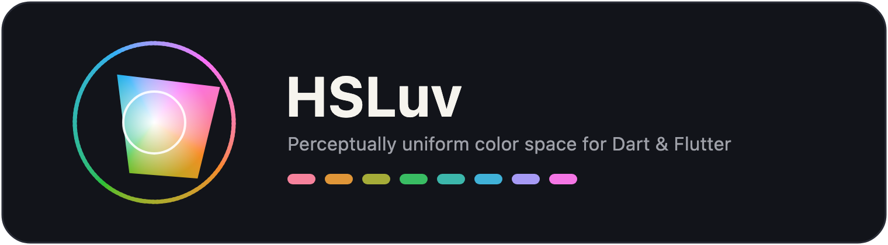
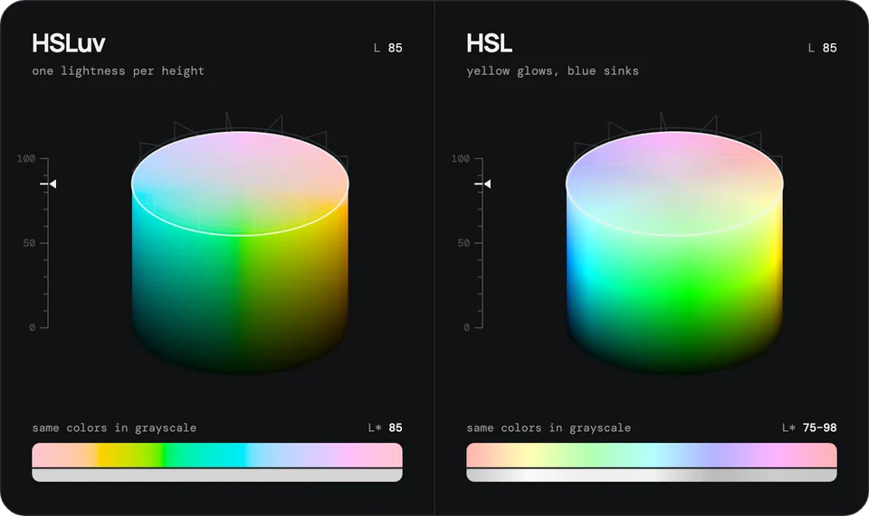
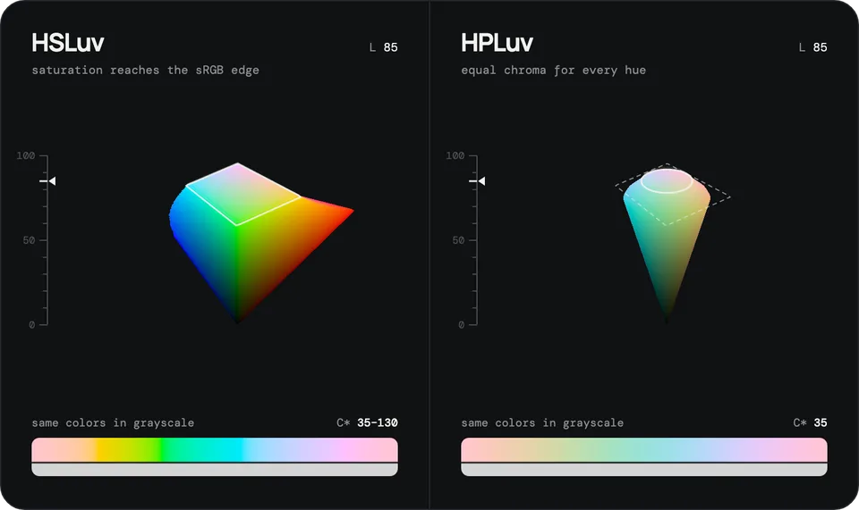
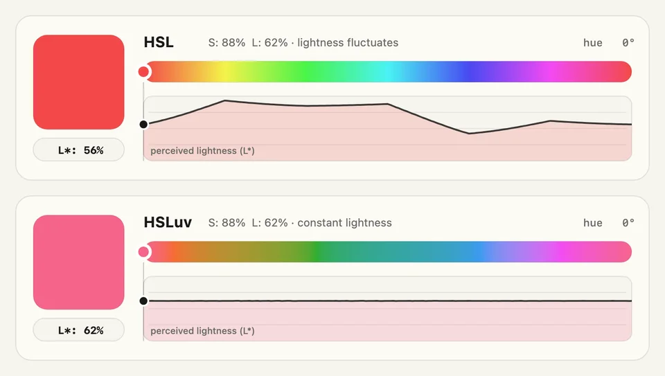

<p align="center">
  
</p>

# HSLuv (and HPLuv) for Dart & Flutter

Dart port of [HSLuv](https://www.hsluv.org) (revision 4), based on the [reference implementation](https://github.com/hsluv/hsluv/tree/main/haxe).

The bundled Flutter example has been deprecated. Explore HSLuv in [Chroma Folio](https://github.com/bernaferrari/chroma-folio) or [try it in your browser](https://bernaferrari.github.io/chroma-folio/).

> HSLuv is a human-friendly alternative to HSL.

It is like HSL, but color only gets perceptually lighter or darker when the Lightness attribute changes.
In HSL, if you go from a green hue to a red one, there will be big differences in the perceived lightness. In HSLuv, almost none.

<p align="center">
  
</p>

Open Solid or Spectrum in Chroma Folio to compare how perceived lightness changes across hues in HSL and HSLuv.
When Hue or Saturation attributes change, there might be minimal changes in contrast (in the 0.01 range), but nothing perceivable and certainly better than HSV/HSL.

This is specially useful when [building acessible color systems](https://stripe.com/blog/accessible-color-systems).
For more information, check: [Designing Color Spaces](https://programmingdesignsystems.com/color/perceptually-uniform-color-spaces/index.html) / [Wikipedia article](https://en.wikipedia.org/wiki/HSLuv)

## HPLuv

<p align="center">
  
</p>

H**P**Luv is a similar color space where the perceptual saturation/chroma (`C*`) stays uniform across every hue. While HSLuv normalizes `(H, S, L)` into a cylinder by stretching each hue out to the irregular sRGB polyhedron boundary in CIELUV chroma (`C*`), HPLuv carves the largest symmetric pastel spindle inside every lightness slice (bounded by the shortest cyan edge, roughly half as saturated as orange around lightness = 60).

You can make a `Color` in HPLuv with `hpluvToRGBColor([hue, saturation, lightness])` where `hue: [0...360]`, `saturation: [0..100]`, `lightness: [0..100]`.

## Usage

In the `pubspec.yaml` of your flutter project, add the following dependency:

[](https://pub.dev/packages/hsluv)

```yaml
dependencies:
  hsluv: ^1.3.0
```

In your project you can use it in two different ways, either low level (directly accessing values as a `List<double>`) or high level (similar to `HSLColor`).
`HSLuvColor` is easier to use, and uses `dart:ui`'s `Color` directly (compatible with both standalone `material_ui` and bundled Flutter apps).

```dart
import 'dart:ui';

import 'package:hsluv/hsluv.dart';

void main() {
  // Low level usage.
  final List<double> hsluvLow = Hsluv.rgbToHsluv([0.2, 0.5, 0.7]);
  print(Hsluv.hsluvToHex(hsluvLow));

  // High level usage.
  final hsluvFromColor = const Color(0xFFEF3E4A).toHSLuv();
  print(hsluvFromColor.toString());

  final hsluvFromHSL = HSLuvColor.fromHSL(300, 70, 60);
  print(hsluvFromHSL.toString());
}
```

<p align="center">
  
</p>

HSL is on top and HSLuv is below (both fixed at `S: 88%`, `L: 62%`). Watch the perceived lightness curve (`L*`) as the hue changes.

### Color values ranges

- RGB values are ranging in `[0...1]`
- HSLuv and HPLuv values have different ranging for their components
  - H : `[0...360]`
  - S and L : `[0...100]`
- LUV has different ranging for their components
  - L\* : `[0...100]`
  - u\* and v\* : `[-100...100]`
- LCh has different ranging for their components
  - L\* : `[0...100]`
  - C\* : `[0...?]` Upper bound varies depending on L\* and H\*
  - H\* : `[0...360]`
- XYZ values are ranging in `[0...1]`

**Important**: Flutter's HSLColor has lightness and saturation ranging from 0 to 1.0. HSLuv uses 0 to 100.

### API functions

#### Note

The passing/returning values, when not `String` are `List<double>` containing each component of the given color space/system in the name's order (for allocation-free tight loops, instantiate `HsluvConverter` and mutate its scalar fields directly):

- RGB : `[red, green, blue]`
- XYZ : `[X, Y, Z]`
- LCH : `[L, C, H]`
- LUV : `[L, u, v]`
- HSLuv/HPLuv : `[H, S, L]`

#### Function listing

- `xyzToRgb(List<double> tuple)`
- `rgbToXyz(List<double> tuple)`
- `xyzToLuv(List<double> tuple)`
- `luvToXyz(List<double> tuple)`
- `luvToLch(List<double> tuple)`
- `lchToLuv(List<double> tuple)`
- `hsluvToLch(List<double> tuple)`
- `lchToHsluv(List<double> tuple)`
- `hpluvToLch(List<double> tuple)`
- `lchToHpluv(List<double> tuple)`
- `lchToRgb(List<double> tuple)`
- `rgbToLch(List<double> tuple)`
- `hsluvToRgb(List<double> tuple)`
- `rgbToHsluv(List<double> tuple)`
- `hpluvToRgb(List<double> tuple)`
- `rgbToHpluv(List<double> tuple)`
- `hsluvToHex(List<double> tuple)`
- `hpluvToHex(List<double> tuple)`
- `hexToHsluv(String s)`
- `hexToHpluv(String s)`
- `rgbToHex(List<double> tuple)`
- `hexToRgb(String hex)`

### Reporting Issues

Issues and Pull Requests are welcome.
You can report [here](https://github.com/bernaferrari/hsluv-dart/issues).

### License

```text
Copyright 2020 Bernardo Ferrari

Permission is hereby granted, free of charge, to any person obtaining a copy of this software and associated documentation files (the "Software"), to deal in the Software without restriction, including without limitation the rights to use, copy, modify, merge, publish, distribute, sublicense, and/or sell copies of the Software, and to permit persons to whom the Software is furnished to do so, subject to the following conditions:

The above copyright notice and this permission notice shall be included in all copies or substantial portions of the Software.

THE SOFTWARE IS PROVIDED "AS IS", WITHOUT WARRANTY OF ANY KIND, EXPRESS OR IMPLIED, INCLUDING BUT NOT LIMITED TO THE WARRANTIES OF MERCHANTABILITY, FITNESS FOR A PARTICULAR PURPOSE AND NONINFRINGEMENT. IN NO EVENT SHALL THE AUTHORS OR COPYRIGHT HOLDERS BE LIABLE FOR ANY CLAIM, DAMAGES OR OTHER LIABILITY, WHETHER IN AN ACTION OF CONTRACT, TORT OR OTHERWISE, ARISING FROM, OUT OF OR IN CONNECTION WITH THE SOFTWARE OR THE USE OR OTHER DEALINGS IN THE SOFTWARE.
```
